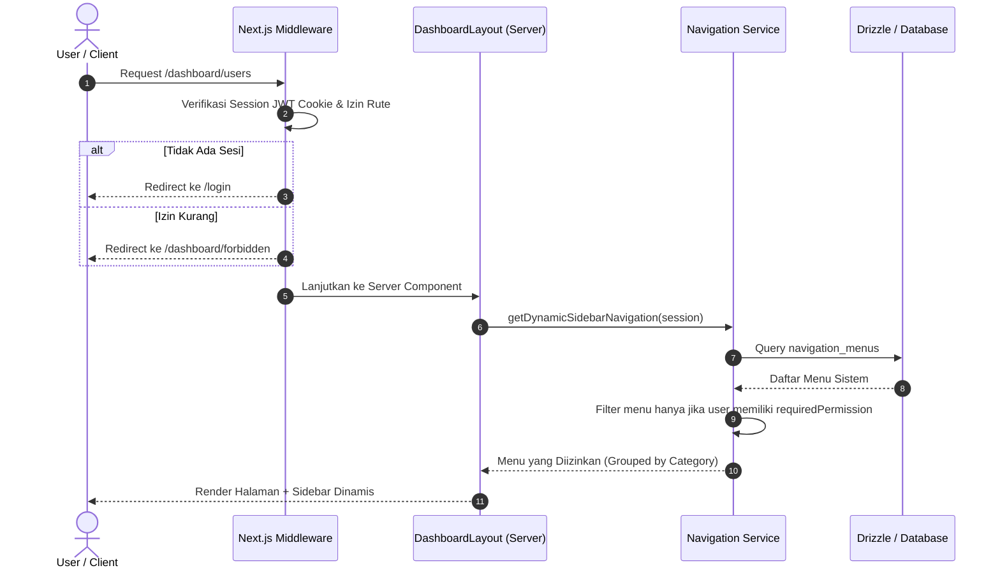
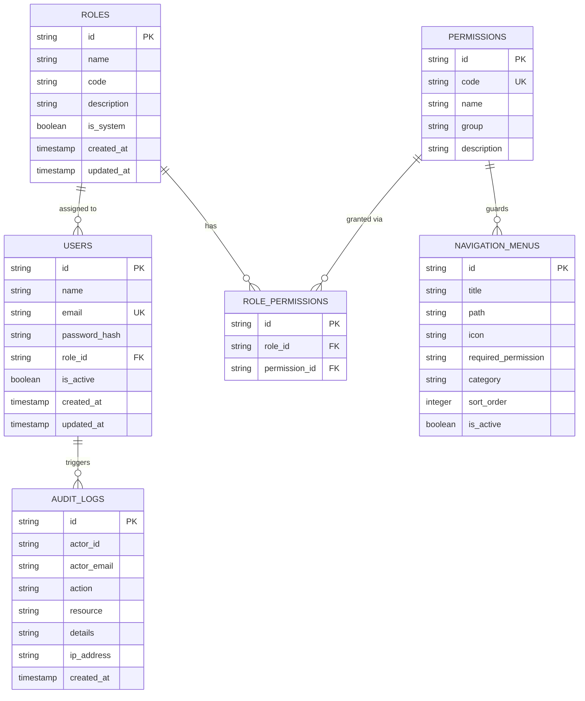

# ARCHITECTURE DOCUMENTATION: SUNDAWA Next.js Starter

## 1. System Overview

Aplikasi ini menggunakan pola **Feature-Driven Architecture (Vertical Slice)** yang dipadukan dengan Next.js App Router.
Arsitektur dirancang agar setiap fitur bisnis terisolasi secara mandiri (cohesive), menyatukan UI components, Server Actions, Domain Service, Repository/Data Access, dan DTO ke dalam foldernya masing-masing di bawah `src/features/`. Folder `src/app/` berfungsi murni sebagai **Thin Routing Layer**.

```
Browser / Client UI
       │
       ▼
Next.js App Router (app/) & Middleware (middleware.ts) [Thin Routing Layer]
       │
       ▼
Feature Components & Server Actions (features/*/components, actions.ts) [Feature Slice Presentation]
       │
       ▼
Feature Domain & Service Layer (features/*/service.ts, dto.ts)           [Business Logic]
       │
       ▼
Feature Repository Layer (features/*/repository.ts)                     [Data Access]
       │
       ▼
Drizzle ORM & LibSQL Database Driver (db/)                              [Persistence Layer]
```

---

## 2. Dynamic RBAC & Sidebar Navigation Flow

Salah satu fitur kunci dari template ini adalah **Dynamic Sidebar Access based on Role Permissions**:



---

## 3. Data Model (ERD)



---

## 4. Multi-Layer Defense-in-Depth Authorization (SEC-07, BE-03, FE-06)

1. **Layer 1: Pre-flight Route Guard (Middleware)**
   - Mengecek token sesi di cookie `sundawa_session`.
   - Mengalihkan pengguna tanpa sesi ke `/login`.
   - Mengecek awalan rute (misal `/dashboard/roles` membutuhkan `roles.read`); jika tidak memiliki izin, dialihkan ke `/dashboard/forbidden`.

2. **Layer 2: Server Component Layout & Page Guard**
   - Setiap page server memanggil `await requirePermission("code")`.
   - Menolak eksekusi query data sensitif jika sesi tidak berwenang.

3. **Layer 3: Server Actions Mutation Guard**
   - Setiap mutasi (`createUserAction`, `updateUserAction`, `deleteUserAction`, `createRoleAction`, `updateRoleAction`, `deleteRoleAction`) secara eksplisit memverifikasi izin actor di sisi server sebelum mengeksekusi operasi database.

4. **Layer 4: UI Dynamic Rendering**
   - Sidebar hanya menampilkan menu yang hak aksesnya dimiliki oleh role pengguna.
   - Tombol "Tambah", "Ubah", dan "Hapus" pada tabel hanya dirender jika role memiliki izin aksi terkait.
